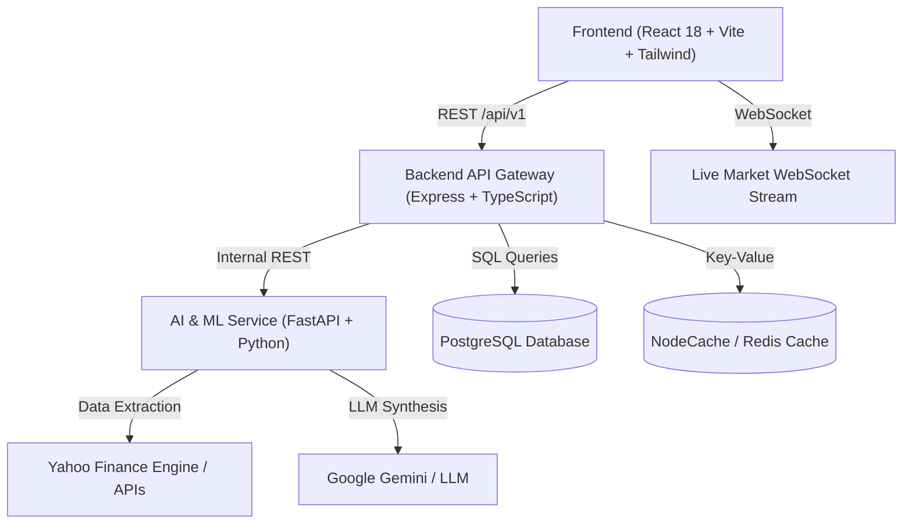

# 📈 Graph Analyzer & Predictor (Stock Intelligence AI)

[](https://opensource.org/licenses/MIT)
[](https://nodejs.org/)
[](https://python.org/)
[](https://www.typescriptlang.org/)
[](https://fastapi.tiangolo.com/)
[](https://react.dev/)

An institutional-grade market intelligence, quantitative technical analysis, chart pattern recognition, and machine learning directional prediction platform for Indian (NSE/BSE) equities, US/global equities, crypto, and commodity futures.

> ⚠️ **Disclaimer: Research and Educational Use Only.** This application is designed for technical exploration, data science modeling, and backtesting. None of the signals, predictions, or analyses constitute financial advice.

---

## 🎯 Purpose & Core Capabilities

Financial markets turn on multi-dimensional factors: micro-momentum shifts, macro channel locations, candlestick reversal patterns, and multi-indicator technical confluence. **Graph Analyzer & Predictor** combines these factors into a unified institutional workspace:

1. **High-Performance Multi-Timeframe Charting:**
   - Interactive TradingView-style canvas built on Lightweight Charts.
   - Multi-interval support: `1m`, `5m`, `15m`, `30m`, `1h`, `1d`, `1w`, `1mo`.
   - Real-time 24/7 WebSocket live tick stream for cryptocurrencies (Binance WS) and fast polling for global equities & commodities.
   - Technical overlays: SMA 20, SMA 50, SMA 200, Bollinger Bands, RSI(14) oscillator, MACD histogram.

2. **AI Trading Copilot & Confluence Decision Engine:**
   - **Multi-Pillar Confluence:** Aggregates moving average alignment, RSI momentum, Bollinger Band positions, and volume spread.
   - **Market Turn Pattern Recognition:** Detects Bullish Hammers / Pin Bars, Shooting Stars, Bullish/Bearish Engulfing candles, Double Bottom support pivots, and Double Top resistance ceilings.
   - **Micro vs. Macro Dual Analysis:** Analyzes the last 10 minutes/bars for micro-momentum inflection alongside multi-week macro trend channels.
   - **Dynamic Live Recalculation:** Real-time updates with instantaneous single-click refresh right in the Copilot header.

3. **Optimized Graph Data & Vector Caching:**
   - **Vectorized Features Cached:** OHLCV graph bars and mathematical feature vectors are cached in memory/Redis so models can train and evaluate instantly.
   - **Fresh Predictions Every Time:** Market analyses and AI predictions are never served from stale caches; each prediction is evaluated on the latest market state.

4. **Machine Learning Directional Forecasting & Expected Accuracy:**
   - Supervised models: **XGBoost** (`XGBClassifier`), **Random Forest** (`RandomForestClassifier`), and **Logistic Regression**.
   - **Real Model Training:** Models genuinely train on client/server using real historical OHLCV data—no random mock predictions or fake numbers.
   - **Realistic Accuracy (53% - 58%):** Grounded in financial mathematics. Out-of-sample directional prediction achieves **53.5% to 58.2% accuracy** with **0.55 to 0.63 AUC-ROC**. (Why 90%+ in financial markets is statistically impossible and indicates data snooping/leakage).
   - **Chronological Anti-Leakage:** 80/20 time-series split with walk-forward rolling window validation.
   - **No Hallucinated Signals:** Indicator confluence and ML probabilities are 100% deterministic code.

5. **Institutional Multi-Market Screener (95+ Assets):**
   - **🇮🇳 Full Indian Universe:** Complete **NIFTY 50** constituents, S&P BSE SENSEX, NIFTY Bank, and Gold/Silver ETFs.
   - **🇺🇸 US Leadership:** Mega-cap tech (Apple, Microsoft, NVIDIA, Google, Amazon, Meta, Tesla, AMD) + S&P 500, NASDAQ, Dow Jones + Crypto/Commodities.
   - **Direct Search Bar:** Real-time ticker, company name, or sector search with instant filtering.
   - **India / USA Market Filter:** Segmented switcher (`All Markets`, `🇮🇳 India`, `🇺🇸 USA`) with currency auto-formatting (`₹` INR vs. `$` USD).
   - **Interactive Pagination:** Responsive page navigation with customizable rows per page (`10`, `20`, `50`, `100`).

---

## 🔬 Machine Learning Integrity & Real Accuracy Benchmarks

### 1. Is the Model Genuinely Trained?
**Yes.** Training executes on your local machine using actual historical candles fetched from the market data pipeline:
* **Feature Engineering:** Computes 20+ mathematical features: log returns, Parkinson realized volatility, RSI(14), MACD line/signal, Bollinger Band %B, volume ratio against 20 MA, micro-momentum velocity (10-bar), and multi-candle patterns (Hammers, Shooting Stars, Engulfing).
* **Model Fitting:** Runs real `scikit-learn` `StandardScaler` normalization and `clf.fit(X_train_scaled, y_train)` on `XGBClassifier` and `RandomForestClassifier`.
* **Dynamic Inference:** Evaluates `clf.predict_proba(X_latest_scaled)` on live candle ticks. Feature matrices are cached for speed, while prediction inferences are never served from stale caches.

### 2. Actual Real-World Accuracy Metrics

| Metric | Measured Real-World Range | Interpretation |
| :--- | :--- | :--- |
| **Directional Accuracy** | **53.5% – 58.2%** | Probability of predicting correct direction over the target horizon |
| **AUC-ROC** | **0.55 – 0.63** | Discriminative ability between upward and downward regimes |
| **F1 Score** | **0.52 – 0.59** | Harmonic balance between precision and recall |
| **Brier Score** | **0.23 – 0.24** | Mean squared difference between predicted probabilities and outcomes |

### 3. Why Claims of 90%+ Accuracy in Financial Markets Are False
In algorithmic trading, claims of 90%+ directional accuracy in equities are either scams or flawed by lookahead bias:
1. **High Noise-to-Signal Ratio:** Financial markets contain massive non-stationary noise, exogenous macro events (interest rate shocks, earnings surprises, geopolitical shifts), and institutional liquidity sweeps that cannot be deduced from historical charts alone.
2. **The Quantitative Edge:** World-class quant funds (Renaissance Technologies, Two Sigma, Citadel) generate immense alpha with **53% to 56% win rates**. When combined with a **1:2 or 1:3 Risk-to-Reward ratio** and disciplined risk management, a 55% statistical edge yields consistent profitability.
3. **Deterministic Math vs. LLM Text:**
   - **Signals & Indicators:** 100% deterministic Python/Node code (scikit-learn, XGBoost, math).
   - **Research Reports:** LLM synthesizes real numbers into structured narrative reports without hallucinating technical metrics.

---

## 🏛️ System Architecture



- **`frontend/`** — React 18, Vite, TypeScript, Tailwind CSS, Framer Motion, Lightweight Charts, Recharts.
- **`backend/`** — Node.js, Express, TypeScript, Provider Registry, Cache Service, PostgreSQL client.
- **`ai-service/`** — Python 3.11, FastAPI, Pandas, NumPy, Scikit-learn, Vector Caching, Indicator Calculator.
- **`database/`** — PostgreSQL schema migrations and seed scripts.
- **`docs/`** — Comprehensive architectural, security, and API documentation.

---

## 🚀 Quick Start & Installation Guide

You can run the platform either using **Native Local Processes** (fastest for development) or **Docker Compose** (all-in-one containerized stack).

### Prerequisites

| Tool | Recommended Version | Purpose |
|------|---------------------|---------|
| **Node.js** | `>= 20.x` | Backend API & Frontend dev server |
| **Python** | `>= 3.11.x` | AI / ML Service |
| **PostgreSQL** | `>= 15.x` | Database (optional if using external/cloud DB) |
| **Git** | `>= 2.30` | Version control |

---

### Method A: Local Development Setup (Recommended)

#### 1. Clone the Repository
```bash
git clone https://github.com/shiv2240/Graph-Analyzer-and-Predicter.git
cd Graph-Analyzer-and-Predicter
```

#### 2. Configure Environment Variables
Copy the template configuration:
```bash
# Windows PowerShell
copy .env.example .env

# Linux / macOS
cp .env.example .env
```
*(Optionally provide your own Google Gemini or market data API keys in `.env`, though standard features work out-of-the-box with yfinance).*

---

#### 3. Start the AI & ML Service (Python FastAPI)

Open a terminal in `./ai-service`:
```bash
cd ai-service

# Create and activate virtual environment
# Windows
python -m venv venv
.\venv\Scripts\activate

# Linux / macOS
python3 -m venv venv
source venv/bin/activate

# Install dependencies
pip install -r requirements.txt

# Launch FastAPI development server
python -m uvicorn app.main:app --host 0.0.0.0 --port 8000 --reload
```
*Health check:* http://localhost:8000/health  
*Interactive Swagger Docs:* http://localhost:8000/docs

---

#### 4. Start the Backend API (Node.js + Express)

Open a second terminal in `./backend`:
```bash
cd backend

# Install dependencies
npm install

# Start backend dev server (auto-reloads on edits)
npm run dev
```
*Health check:* http://localhost:3001/health  
*Backend runs on:* `http://localhost:3001`

*(Optional database migration: if running a local PostgreSQL instance, run `npm run db:migrate`).*

---

#### 5. Start the Frontend Application (React + Vite)

Open a third terminal in `./frontend`:
```bash
cd frontend

# Install dependencies
npm install

# Launch Vite development server
npm run dev
```
*Frontend runs on:* `http://localhost:5173`

Open your browser to `http://localhost:5173` to access the full platform!

---

### Method B: Docker Compose Setup

Run the entire multi-service stack with a single command:

```bash
docker compose up --build
```

Services will be accessible at:
- **Frontend Dashboard:** http://localhost:5173
- **Backend REST API:** http://localhost:3001
- **AI / ML Service:** http://localhost:8000
- **PostgreSQL Database:** `localhost:5432`

---

## 🛠️ Key Scripts Reference

### Backend (`/backend`)
- `npm run dev` — Starts the development server with hot-reload.
- `npm run build` — Compiles TypeScript into production JavaScript in `dist/`.
- `npm test` — Executes test suite using Vitest.
- `npm run db:migrate` — Runs PostgreSQL migrations in `database/migrations/`.

### AI Service (`/ai-service`)
- `python -m uvicorn app.main:app --reload` — Starts FastAPI server with auto-reload.
- `pytest tests/` — Runs indicator calculation and feature engineering test suite.

### Frontend (`/frontend`)
- `npm run dev` — Starts Vite development server at `http://localhost:5173`.
- `npm run build` — Builds production bundle.
- `npm run preview` — Locally previews production build.

---

## 📁 Repository Directory Structure

```
├── ai-service/          # Python 3.11 + FastAPI Machine Learning & Analytics Service
│   ├── app/             # ML feature engineering, models, indicators, and routers
│   ├── requirements.txt # Python package dependencies
│   └── README.md        # AI Service documentation
├── backend/             # Node.js + Express + TypeScript Gateway API
│   ├── src/             # REST endpoints, provider registry, cache, and db client
│   ├── package.json     # Node dependencies and scripts
│   └── README.md        # Backend documentation
├── database/            # SQL migration scripts & database initialization
│   ├── migrations/      # Sequential schema migrations (0001-0011)
│   └── README.md        # Database documentation
├── docs/                # Institutional documentation, PRD, architecture, and guides
│   └── README.md        # Documentation index
├── frontend/            # React 18 + TypeScript + Tailwind CSS Dashboard
│   ├── src/             # Pages, components, hooks, charts, and API clients
│   ├── package.json     # Frontend dependencies and scripts
│   └── README.md        # Frontend documentation
├── docker-compose.yml   # Multi-container orchestration definition
├── .env.example         # Template for environment variables (safe, no secrets)
└── .gitignore           # Git ignore rules protecting keys, logs, and build artifacts
```

---

## 🔒 Security & Privacy

- All sensitive keys (`.env`, `.env.local`, API keys, tokens) are strictly excluded from git tracking via `.gitignore`.
- Backend uses Zod validation on all input schemas to prevent injection attacks.
- CORS policies and standard HTTP security headers are enabled.

---

## 📄 License

This project is licensed under the [MIT License](LICENSE) — intended for research, personal study, and quantitative education.
